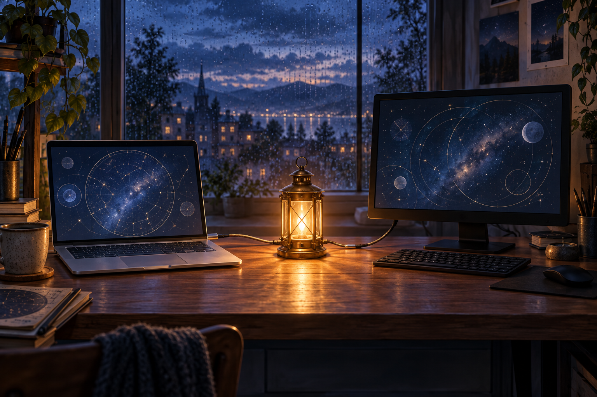
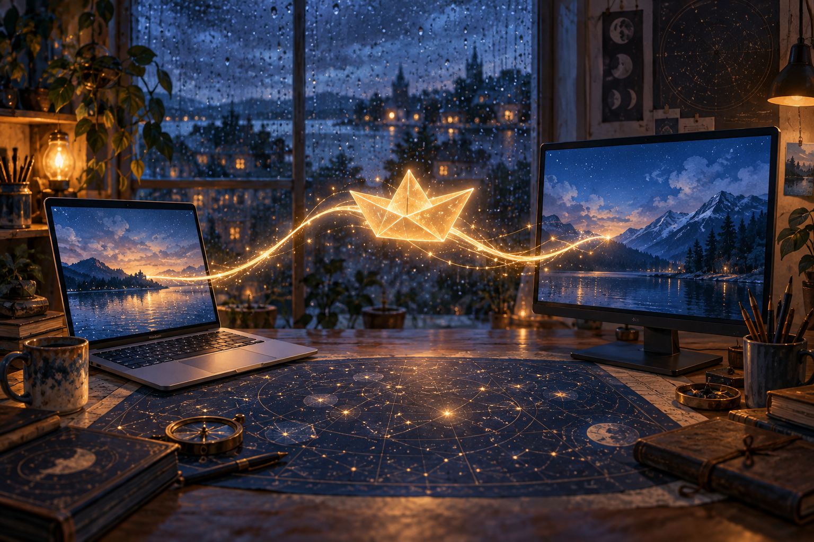

# The Lantern Between Screens

## Opening — Windows

Aya noticed the lantern at 11:47 p.m., glowing in the narrow space between her monitor and the rain-dark window. It was no taller than a coffee mug, yet its amber light spread across her desk without casting a shadow. On her Windows screen, a blank connection window waited for the Mac across the room—and, many miles beyond it, for Marin.

Aya lifted the lantern. The connection window flickered. Instead of status text, it showed a small paper boat floating on black water. A second boat appeared beside it, folded from a page covered in Marin’s handwriting. Aya could not read the words, but she recognized the sharp upward stroke of his signature.

She set the lantern beside the keyboard and typed a test message: *Can you see this?*

The paper boats turned toward each other. A line of light stretched between their bows, as thin as thread and steady as a held breath. Somewhere beyond Aya’s speakers came three soft taps—the old signal she and Marin had agreed to use when the ordinary connection failed.

Aya smiled, opened a fresh message, and sent one precise request: **Marin, follow the light bridge, tell me what you find on the other side, and send the paper boat back.**

## Middle Scene — Mac Contribution

Marin saw Aya’s request arrive as amber letters on his Mac, each word reflected in the black water beneath the paper boats. When he touched the trackpad, the lantern’s glow poured through the screen and formed a narrow bridge across the room. He stepped onto it before doubt could anchor him.

The bridge carried him between sleeping windows: a half-written song, a map marked with old routes, and a photograph of Aya laughing beneath summer rain. Below, lost messages drifted like silver fish. Marin followed the three-tap rhythm until he reached a small island made from unsent drafts. At its center stood Aya’s paper boat, caught beneath a glass bell.

He lifted the bell. The boat unfolded into a page bearing the sentence they had once promised never to forget: *A connection is not the distance disappearing; it is two people choosing to cross it.* Marin folded the page again, tucked his own reply inside, and set the boat on the shining thread.

It sailed toward Aya. As the bridge dimmed, Marin tapped three times and watched the lantern answer from the other screen.

### Marin’s Reflection

Marin understood that the lantern had not repaired their machines or erased the miles between them. It had simply made their trust visible. Sending the boat back felt like an ordinary act, but that was its magic: every lasting bridge was built from small replies, offered faithfully across the dark.

## Final Verification — Windows

> **Reserved for Aya (Windows):** Verify continuity, confirm both image links, and write the ending after the Mac contribution is complete.
